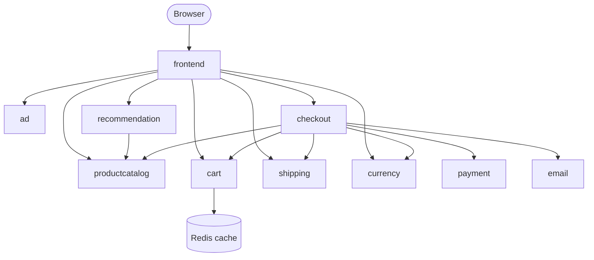

# Deploying a Microservices Application on Kubernetes (Production & Security Best Practices)

A hands-on project where I deployed Google's [Online Boutique microservices demo](https://github.com/GoogleCloudPlatform/microservices-demo) on Kubernetes, applying production and security best practices along the way.

---

## What I Built

- 11 microservices, each with its own **Deployment** and **Service** in a single YAML file
- A **Kubernetes cluster with 3 worker nodes**, created with Terraform (from my [Terraform EKS project]([https://github.com/lihandafabius](https://github.com/lihandafabius/terraform-eks-infrastructure)))
- A dedicated **Namespace** holding the whole application
- Only the **frontend is public** (LoadBalancer). Every other service is internal (ClusterIP)

## Architecture



The frontend is the only entry point. Services communicate inside the cluster by name, e.g. `productcatalogservice:3550`.

## How to Deploy


---

## Production Best Practices

### 1. Pin image versions
Never rely on `latest`. It can change without notice and break the application. A pinned version makes deployments predictable and clear.

```yaml
containers:
- name: service
  image: gcr.io/google-samples/microservices-demo/frontend:v0.8.0   # pinned, not :latest
```

### 2. Liveness probes
Kubernetes knows whether a pod is running, not whether the application inside is healthy. A liveness probe checks the application and restarts the container if it stops responding.

```yaml
livenessProbe:
  grpc:
    port: 8080
  periodSeconds: 5        # check every 5 seconds
```

### 3. Readiness probes
A readiness probe tells Kubernetes when the application is ready to receive traffic. Until it passes, the pod is kept out of the Service endpoints.

```yaml
readinessProbe:
  httpGet:
    path: "/_healthz"
    port: 8080
  periodSeconds: 5
```

### 4. Resource requests & limits
Prevents one faulty container from consuming all cluster resources.
- **Requests**: the minimum a container is guaranteed. The scheduler uses this to pick a node.
- **Limits**: the maximum it may use.

If a request is larger than your biggest node, the pod will never be scheduled.

```yaml
resources:
  requests:
    cpu: 200m
    memory: 180Mi
  limits:
    cpu: 300m
    memory: 300Mi
```

### 5. Don't use NodePort in production
NodePort opens a port on every worker node, increasing the attack surface. Use a **LoadBalancer** or **Ingress** for a single controlled entry point, and keep everything else internal.

```yaml
# Frontend: the only public service
spec:
  type: LoadBalancer
---
# All other services: internal only
spec:
  type: ClusterIP
```

### 6. Run more than one replica
A single replica means downtime if it crashes. Multiple replicas keep the application available. Kubernetes defaults to 1 if not specified.

```yaml
spec:
  replicas: 2
```

> Redis stays at `replicas: 1` on purpose: multiple unclustered Redis instances would hold inconsistent data.

### 7. Use more than one worker node
A single node is a single point of failure (crashes, maintenance, update reboots). With 3 nodes, replicas spread out and the application survives losing one.


### 8. Label everything
Labels are key-value pairs used to identify and group resources. Services use them to find their Pods.

```yaml
# Pod template carries the label...
template:
  metadata:
    labels:
      app: frontend
# ...and the Service selects it
spec:
  selector:
    app: frontend
```

### 9. Use namespaces
Namespaces organise resources and allow access rights to be defined per namespace.

```bash
kubectl create namespace microservices
kubectl apply -f config.yaml -n microservices
```

---

## Security Best Practices

### 10. Scan images for vulnerabilities
Base images and third-party libraries can contain known vulnerabilities. Scan images manually or, better, automatically in the CI/CD pipeline.


### 11. Don't run containers as root
A compromised root container has access to host-level resources, which makes the potential damage much greater.


### 12. Keep Kubernetes up to date
New versions include patches for known security issues. With multiple nodes and replicas on different nodes, upgrades can be done with zero downtime.


---
