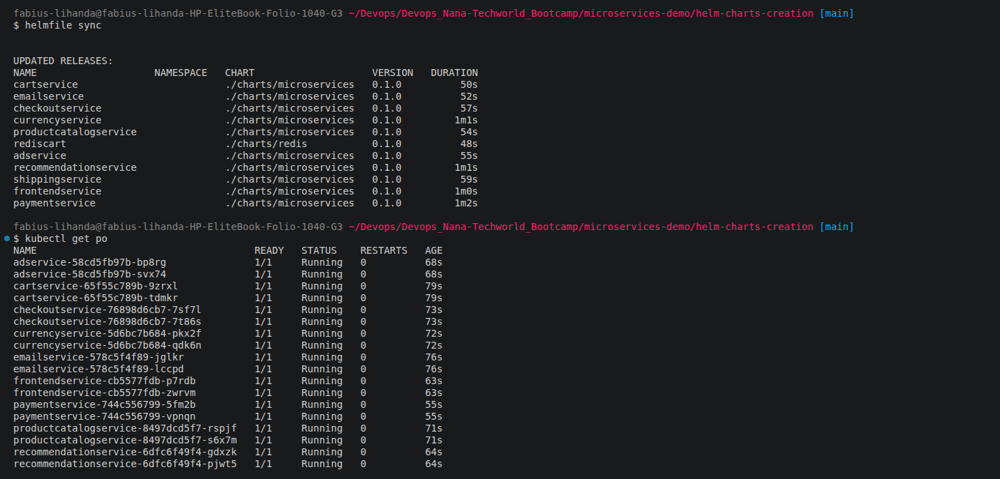
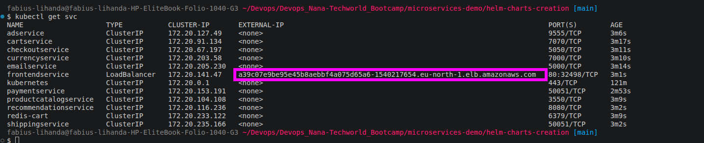
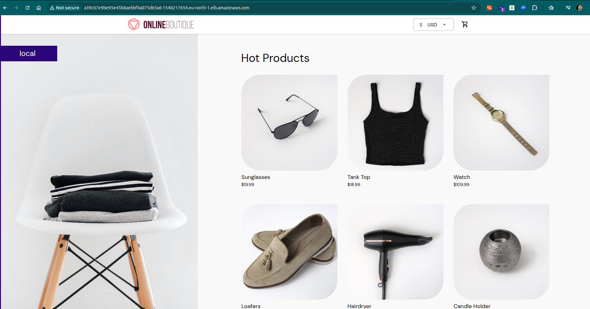

<table>
  <tr>
    <td width="70" align="center" valign="middle">
      
    </td>
    <td valign="middle">
      <h1 style="border-bottom: none; margin: 0; padding: 0; line-height: 1.2;">Microservices on Kubernetes</h1>
      <span style="font-size: 15px; color: #57606a;">Deploying with Helm &amp; Helmfile using Production and Security Best Practices</span>
    </td>
  </tr>
</table>

---
This project demonstrates how to deploy Google's [Online Boutique microservices demo](https://github.com/GoogleCloudPlatform/microservices-demo) on Kubernetes following production and security best practices. The cluster was provisioned with Terraform in my [previous project](https://github.com/lihandafabius/terraform-eks-infrastructure).

The application was first deployed using a **plain Kubernetes manifest** with 11 Deployments and Services, then packaged into reusable **Helm charts**, and finally managed declaratively using **Helmfile**. Only the **frontend** is exposed publicly through a LoadBalancer, while every other service stays internal.

---

## Architecture


---

## Project objectives

* Deploying 11 microservices on a Kubernetes cluster with **3 worker nodes**
* Isolating the application in its own **Namespace**
* Creating a reusable **Helm chart** shared by 10 services, plus a separate chart for **Redis**
* Keeping service-specific configuration in **one values file per service**
* Installing everything in one go with **shell scripts**
* Managing all releases declaratively with **Helmfile**
* Applying Kubernetes **production and security best practices**

## Project structure

One `microservices` chart is reused by every service except Redis, which has its own chart. Anything that differs between services (name, image, ports, environment variables) lives in the `values/` folder, so the chart itself never changes.

```text
microservices-demo/
├── config.yaml                  # Plain manifest (no Helm)
└── helm-charts-creation/
    ├── charts/
    │   ├── microservices/       # Shared chart for 10 services
    │   │   ├── Chart.yaml
    │   │   ├── values.yaml
    │   │   └── templates/
    │   │       ├── deployment.yaml
    │   │       ├── service.yaml
    │   │       └── _helpers.tpl
    │   └── redis/               # Redis chart
    │       ├── Chart.yaml
    │       ├── values.yaml
    │       └── templates/
    │           ├── deployment.yaml
    │           ├── service.yaml
    │           └── _helpers.tpl
    ├── values/                  # One values file per service
    │   ├── ad-service-values.yaml
    │   ├── cart-service-values.yaml
    │   ├── checkout-service-values.yaml
    │   ├── currency-service-values.yaml
    │   ├── email-service-values.yaml
    │   ├── frontend-values.yaml
    │   ├── payment-service-values.yaml
    │   ├── productcatalog-service-values.yaml
    │   ├── recommendation-service-values.yaml
    │   ├── redis-values.yaml
    │   └── shipping-service-values.yaml
    ├── helmfile.yaml
    ├── install.sh
    └── uninstall.sh
```

---
<details>
<summary>Deploy with a plain manifest</summary>

<br />

All 11 Deployments and Services were first written in a single `config.yaml`, with the best practices (listed at the end) added as the file grew. A namespace was created and everything was deployed into it.

```bash
kubectl create namespace microservices
kubectl apply -f config.yaml -n microservices
kubectl get pods -n microservices
kubectl get svc frontend -n microservices   # get alb adress
```

</details>

---
<details>
<summary>Package the services into Helm charts</summary>

<br />

**Helm** is the package manager for Kubernetes, and a **Helm chart** is a package of templated Kubernetes manifests (Deployment, Service, and so on) that can be configured through a values file. Instead of writing a separate YAML manifest for every service, the manifests are written once as templates and the parts that change are replaced with values at install time.

**Why Helm charts matter:**

* **Reusability:** one chart can deploy many services, which removes duplicated YAML
* **Configurability:** differences between services (name, image, replicas, ports, environment variables) are passed in through values files, so the chart never needs to be edited
* **Consistency:** every service is deployed with the same structure and the same best practices
* **Easier maintenance:** a change to the template (for example adding a probe) is made once and applies to all services that use the chart
* **Release management:** each install is tracked as a release, so it can be listed, upgraded, rolled back or uninstalled with a single command

Ten of the eleven services share the same structure, so they use **one** `microservices` chart. Redis is stateful and has its own chart. Each service only supplies a values file with its name, image, version, replicas, ports and environment variables.

### Install and uninstall scripts

Installing 11 releases one by one is slow, so the commands were placed in `install.sh`. Redis goes first because the cart service depends on it. `uninstall.sh` does the reverse using `helm uninstall`.

```bash
helm install rediscart ./charts/redis -f values/redis-values.yaml -n microservices
helm install cartservice ./charts/microservices -f values/cart-service-values.yaml -n microservices
helm install checkoutservice ./charts/microservices -f values/checkout-service-values.yaml -n microservices
helm install currencyservice ./charts/microservices -f values/currency-service-values.yaml -n microservices
helm install paymentservice ./charts/microservices -f values/payment-service-values.yaml -n microservices
helm install productcatalogservice ./charts/microservices -f values/productcatalog-service-values.yaml -n microservices
helm install emailservice ./charts/microservices -f values/email-service-values.yaml -n microservices
helm install recommendationservice ./charts/microservices -f values/recommendation-service-values.yaml -n microservices
helm install shippingservice ./charts/microservices -f values/shipping-service-values.yaml -n microservices
helm install frontendservice ./charts/microservices -f values/frontend-values.yaml -n microservices
```

</details>

---
<details>
<summary>Manage releases declaratively with Helmfile</summary>

<br />

The scripts only run commands, they don't describe the desired state of the application. **Helmfile** fixes this by declaring every release in one file, which allows us to:

* Keep a directory of chart values files and maintain changes in version control
* Apply CI/CD to configuration changes
* Periodically sync to avoid skew in environments

```yaml
releases:
  - name: rediscart
    chart: ./charts/redis
    values:
      - values/redis-values.yaml
      - appReplicas: "1" # Override the default value for appReplicas to 1
      - volumeName: "redis-cart-data" # Override the default value for volumeName to "redis-data"

  - name: cartservice
    chart: ./charts/microservices
    values:
      - values/cart-service-values.yaml

  - name: frontendservice
    chart: ./charts/microservices
    values:
      - values/frontend-values.yaml

  - name: recommendationservice
    chart: ./charts/microservices
    values:
      - values/recommendation-service-values.yaml

  - name: shippingservice
    chart: ./charts/microservices
    values:
      - values/shipping-service-values.yaml

  - name: checkoutservice
    chart: ./charts/microservices
    values:
      - values/checkout-service-values.yaml

  - name: adservice
    chart: ./charts/microservices
    values:
      - values/ad-service-values.yaml

  - name: emailservice
    chart: ./charts/microservices
    values:
      - values/email-service-values.yaml

  - name: productcatalogservice
    chart: ./charts/microservices
    values:
      - values/productcatalog-service-values.yaml

  - name: currencyservice
    chart: ./charts/microservices
    values:
      - values/currency-service-values.yaml

  - name: paymentservice
    chart: ./charts/microservices
    values:
      - values/payment-service-values.yaml
```

**Prerequisites:** `helm`, `helmfile`, and the `helm-diff` plugin (needed by `diff` and `apply`).
 
```bash
helm plugin install https://github.com/databus23/helm-diff
```

Useful Helmfile commands to remember

| Command | What it does |
|---|---|
| `helmfile sync` | Installs or updates **every** release declared in `helmfile.yaml` |
| `helmfile diff` | Previews what would change in the cluster without applying anything |
| `helmfile apply` | Runs a `diff` first, then syncs **only the releases that changed** |
| `helmfile destroy` | Removes all releases declared in `helmfile.yaml` |
| `helm list` | Lists the releases installed in the namespace |




Verify the microservice application in the browser






</details>

---
<details>
<summary>Production and Security Best Practices</summary>

<br />

**1. Pin image versions.** `latest` can change without notice and break the application, a pinned version keeps deployments predictable.

```yaml
image: gcr.io/google-samples/microservices-demo/frontend:v0.8.0
```

**2. Liveness probes.** Kubernetes knows whether a pod is running, not whether the application inside is healthy. A liveness probe restarts the container if it stops responding.

```yaml
livenessProbe:
  grpc:
    port: 8080
  periodSeconds: 5
```

**3. Readiness probes.** Tells Kubernetes when the application is ready to receive traffic.

```yaml
readinessProbe:
  httpGet:
    path: "/_healthz"
    port: 8080
  periodSeconds: 5
```

**4. Resource requests and limits.** Stops one faulty container from consuming all cluster resources. Requests are what a container is guaranteed (used by the scheduler), limits are the maximum it can use.

```yaml
resources:
  requests:
    cpu: 200m
    memory: 180Mi
  limits:
    cpu: 300m
    memory: 300Mi
```

**5. No NodePort in production.** NodePort exposes every worker node and increases the attack surface. Use a LoadBalancer or Ingress and keep everything else internal.

```yaml
type: LoadBalancer   # frontend only
type: ClusterIP      # all other services
```

**6. More than one replica.** One replica means downtime if it crashes (Kubernetes defaults to 1). Redis stays at 1 on purpose to avoid data inconsistency between instances.

```yaml
replicas: 2
```

**7. More than one worker node.** A single node is a single point of failure. This cluster runs 3.

**8. Label everything.** Labels identify and group resources, and Services use them to find their Pods.

```yaml
labels:
  app: frontend
```

**9. Use namespaces.** They organise resources and let access rights be defined per namespace.

```bash
kubectl create namespace microservices
```

**10. Scan images for vulnerabilities.** Base images and third-party libraries can have known vulnerabilities, scan manually or automatically in the CI/CD pipeline.

**11. No root access for containers.** A compromised root container has access to host-level resources, which makes the damage much greater.

**12. Keep Kubernetes up to date.** New versions patch security issues, and with multiple nodes and replicas upgrades can be done with zero downtime.

</details>
