<table>
  <tr>
    <td width="70" align="center" valign="middle">
      
    </td>
    <td valign="middle">
      <h1 style="border-bottom: none; margin: 0; padding: 0; line-height: 1.2;">Monitoring and Observability with Prometheus</h1>
      <span style="font-size: 15px; color: #57606a;">Metrics, Alerting and Notifications for a Java + MySQL Application on Kubernetes</span>
    </td>
  </tr>
</table>

---

**Monitoring** is the continuous collection and watching of data (metrics) from your systems, so you know whether they are healthy. **Observability** goes one step further: it is being able to understand *why* something is happening inside a system, using the data it produces.

### Why monitoring and observability matter

- **Visibility in dynamic environments:** containers constantly start, stop and move, which makes them much harder to keep track of than fixed servers.
- **Visibility at every level:** with hundreds or thousands of containers, plus components across infrastructure, platform and application, you need one consistent view of all of them.
- **No more black box:** without visibility, when something breaks you have no idea what is happening, what caused it or what is not working.
- **Faster root cause analysis:** monitoring points directly at the cause of a problem, which saves a lot of time and effort, and with them a lot of money.
- **Problems caught before they happen:** the people responsible for the infrastructure are alerted early instead of after users are affected.
- **Early warning on resources:** notifications can fire when critical resources such as storage or memory cross a warning threshold (for example 50%). That gives the team time to plan capacity and request more, which often needs approval and justification, before anything actually runs out.

### How Prometheus helps

**Prometheus** is a widely used, open source monitoring tool with a large community, and it fits Kubernetes particularly well. It continuously **scrapes metrics** from the cluster and its applications, stores them as time series, evaluates **alert rules** against them, and hands firing alerts to **Alertmanager**, which notifies the right people through the right channel. **Grafana** sits on top to visualise the data.

### What this project builds

This project adds that visibility to an existing setup: a Java application backed by MySQL, exposed through an Nginx Ingress, running on Kubernetes. It is split into **five exercises that build on each other**: deploying the application, collecting metrics from every component, defining alerts, routing notifications to Slack and email, and finally simulating real failures to prove the whole chain works end to end. A Grafana dashboard sits on top to make the traffic visible.

## Project objectives

Across the exercises, these were my main objectives:

* Deploy the **Prometheus Operator** (`kube-prometheus-stack`) and understand how `ServiceMonitor`, `PrometheusRule` and `AlertmanagerConfig` custom resources drive it.
* Collect metrics from three different sources: the **Nginx Ingress Controller** (built-in metrics), **MySQL** (a separate exporter) and a **custom Java application** (client library with its own metrics port).
* Write **PromQL alert rules** for application and cluster problems, and understand the Pending → Firing alert lifecycle.
* Route alerts by **team**: Java and MySQL alerts to a Slack channel, Nginx and Kubernetes alerts to an administrator's email.
* **Test the alerting pipeline** by simulating real failures instead of assuming the configuration works.
* Visualise traffic and health with **Grafana**, and keep the whole setup reproducible through an Ansible playbook.
* Develop practical troubleshooting skills across Prometheus, Alertmanager, Helm and Kubernetes.

## Project Structure

```
.
├── project-vars                                         # Shared variables (kubeconfig, Docker Hub credentials, paths)
├── images/                                              # Screenshots referenced throughout this README
├── java-app/                                            # Gradle/Spring Boot source + Dockerfile for the Java app
│
├── deploy_java_mysql_app_with_new_alb_address.yaml      # Exercises 1-4 — one playbook that builds the whole stack
│
├── alert-rules.yaml                                     # Exercise 3 — PrometheusRule (5 alert rules)
├── alert-manager-configuration.yaml                     # Exercise 4 — AlertmanagerConfig (Slack + email routing)
├── slack-secret.yaml                                    # Exercise 4 — Slack webhook URL (not committed)
├── email-secret.yaml                                    # Exercise 4 — Gmail app password (not committed)
│
├── trigger_javaapp_alert.sh                             # Exercise 5 — load on /get-data (Java alert, Slack)
├── trigger_nginx_alert.sh                               # Exercise 5 — requests to a missing path (Nginx 4xx alert, email)
│
└── k8_manifests/                                        # Kubernetes manifests applied by the playbook
    ├── application-deployment.yaml                      # Java app Deployment + Service + ServiceMonitor
    ├── applicationconfig.yaml                           # ConfigMap (DB_SERVER, DB_NAME)
    ├── mysql_secret.yaml                                # MySQL credentials Secret
    ├── helm-mysql-values.yaml                           # Bitnami MySQL chart values (replication + metrics)
    └── ingress.yaml                                     # Ingress rule for the Java app
```

---

## Prerequisites

The playbook needs a few Python libraries and Ansible collections on the machine running it, plus the usual Kubernetes tooling.

```bash
python3 -m venv venv
source venv/bin/activate
pip install ansible docker kubernetes
ansible-galaxy collection install community.docker kubernetes.core
```

Other requirements:

- A running Kubernetes cluster (this project uses Amazon EKS) and its kubeconfig
- `kubectl` and `helm` installed locally
- A Docker Hub account to push the Java app image
- A **Slack** workspace with an incoming webhook 
- A **Gmail app password** for the email notifications (a normal password does not work with SMTP)

---

<details>
<summary> Exercise 1: Deploy the Application and Prepare the Setup</summary>
<br />
The starting point is a setup that is already running: a Java application with 3 replicas talking to MySQL, reachable from a browser through an Nginx Ingress.
  
The cluster itself was provisioned separately via Terraform (see [Terraform EKS project](https://github.com/lihandafabius/terraform-eks-infrastructure)). 
 
| Component | Deployment | Detail |
|---|---|---|
| Java application | Deployment + Service | 3 replicas, image pushed to Docker Hub |
| MySQL | Bitnami Helm chart | `architecture: replication`, 1 primary and 2 secondary replicas |
| Ingress controller | `ingress-nginx` Helm chart | Exposed through an AWS load balancer |
| Ingress rule | `ingress.yaml` | Routes the load balancer hostname to the Java service |
 
### Implementation
 
The setup for this exercise is deployed by a single Ansible playbook, adapted from the earlier [Ansible project](https://github.com/lihandafabius/Devops_Nana-Techworld_Bootcamp/tree/main/ansible-exercises). 

It creates the namespace, deploys the ingress controller, builds and pushes the Java application image, and then deploys MySQL, the application and the Ingress rule:
 
```yaml
---
- name: Deploy java mysql app to k8's cluster
  hosts: localhost
  vars_files:
    - project-vars
 
 
  tasks:
    - name: Create java app namespace
      kubernetes.core.k8s:
        name: java-app
        api_version: v1
        kind: Namespace
        state: present
        kubeconfig: "{{ kubeconfig }}"
 
    - name: Add NGINX Ingress Repository
      kubernetes.core.helm_repository:
        name: ingress-nginx
        repo_url: https://kubernetes.github.io/ingress-nginx
 
    - name: Deploy NGINX Ingress Controller via Helm
      kubernetes.core.helm:
        name: ingress-nginx
        chart_ref: ingress-nginx/ingress-nginx
        release_namespace: ingress-nginx
        create_namespace: true
        kubeconfig: "{{ kubeconfig }}"
 
    # ---- Optional: automatic ALB address update ----
    - name: Get NGINX Ingress LoadBalancer Hostname
      kubernetes.core.k8s_info:
        kubeconfig: "{{ kubeconfig }}"
        kind: Service
        name: ingress-nginx-controller
        namespace: ingress-nginx
      register: ingress_service
      until: ingress_service.resources[0].status.loadBalancer.ingress[0].hostname is defined
      retries: 20
      delay: 5
 
    - name: Set ALB Hostname Variable
      ansible.builtin.set_fact:
        alb_hostname: "{{ ingress_service.resources[0].status.loadBalancer.ingress[0].hostname }}"
 
    - name: Update host in ingress.yaml manifest
      ansible.builtin.replace:
        path: "{{ manifest_dir }}/ingress.yaml"
        regexp: '(host:\s*).*'
        replace: '\1"{{ alb_hostname }}"'
 
    - name: Update const HOST in index.html frontend file
      ansible.builtin.replace:
        path: "{{ docker_app_dir }}/src/main/resources/static/index.html"
        regexp: 'const HOST = ".*";'
        replace: 'const HOST = "{{ alb_hostname }}";'
    # ---- End of optional ALB address update ----
 
    - name: Build Gradle project to package updated frontend JAR
      ansible.builtin.command: ./gradlew clean build
      args:
        chdir: "{{ docker_app_dir }}"
 
    - name: Log in to Docker Hub
      community.docker.docker_login:
        username: "{{ docker_username }}"
        password: "{{ docker_password }}"
 
    - name: Build Docker image for Java App
      community.docker.docker_image:
        build:
          path: "{{ docker_app_dir }}"
        name: "{{ docker_image }}"
        source: build
        force_source: true
 
    - name: Push Java App image to Docker Hub
      community.docker.docker_image:
        name: "{{ docker_image }}"
        push: true
        source: local
 
    - name: Create Docker registry secret for image pull
      kubernetes.core.k8s:
        kubeconfig: "{{ kubeconfig }}"
        state: present
        definition:
          apiVersion: v1
          kind: Secret
          metadata:
            name: my-registry-key
            namespace: java-app
          type: kubernetes.io/dockerconfigjson
          stringData:
            .dockerconfigjson: "{{ {'auths': {'https://index.docker.io/v1/': {'username': docker_username, 'password': docker_password, 'auth': (docker_username + ':' + docker_password) | b64encode}}} | to_json }}"
 
    - name: Apply mysql secret
      kubernetes.core.k8s:
        src: "{{ manifest_dir }}/mysql_secret.yaml"
        state: present
        kubeconfig: "{{ kubeconfig }}"
 
    - name: Apply mysql configmap
      kubernetes.core.k8s:
        src: "{{ manifest_dir }}/applicationconfig.yaml"
        state: present
        kubeconfig: "{{ kubeconfig }}"
 
    - name: Deploy MySQL via Helm charts
      kubernetes.core.helm:
        name: mysql
        chart_ref: bitnami/mysql
        release_namespace: java-app
        kubeconfig: "{{ kubeconfig }}"
        values_files:
          - "{{ manifest_dir }}/helm-mysql-values.yaml"
 
    - name: Deploy Java Application and Service
      kubernetes.core.k8s:
        src: "{{ manifest_dir }}/application-deployment.yaml"
        state: present
        kubeconfig: "{{ kubeconfig }}"
 
    - name: Apply Ingress rule for Java App
      kubernetes.core.k8s:
        src: "{{ manifest_dir }}/ingress.yaml"
        state: present
        kubeconfig: "{{ kubeconfig }}"

```
 
The manifests and values applied by the playbook can be found in [`k8_manifests`](k8_manifests):
 
- [`application-deployment.yaml`](k8_manifests/application-deployment.yaml): Java application Deployment (3 replicas) and Service
- [`applicationconfig.yaml`](k8_manifests/applicationconfig.yaml): ConfigMap with the database connection details
- [`mysql_secret.yaml`](k8_manifests/mysql_secret.yaml): MySQL credentials Secret
- [`helm-mysql-values.yaml`](k8_manifests/helm-mysql-values.yaml): Bitnami MySQL chart values (replication with 1 primary and 2 secondary replicas)
- [`ingress.yaml`](k8_manifests/ingress.yaml): Ingress rule for the Java application

### Optional automation: the ALB address
 
The AWS load balancer only gets its hostname once the ingress controller exists, so that hostname cannot be written into any file beforehand. Four optional tasks, marked with comments in the playbook, remove this manual step. After the ingress controller is deployed, the playbook reads the hostname from the `ingress-nginx-controller` Service, waiting until AWS has assigned it, and then uses it in two places:
 
- **The Ingress rule:** the `host` field of `ingress.yaml` is replaced with the new hostname, so the rule always matches the current load balancer.
- **The Java application:** the `const HOST` value in the frontend's `index.html` is replaced as well. The application is then rebuilt with Gradle and packaged into a fresh Docker image, so the frontend calls the correct address.
This part is optional, since both values can also be edited by hand. Without these tasks, every rebuild of the cluster, which produces a new load balancer hostname, would need two manual edits before the application worked.
 
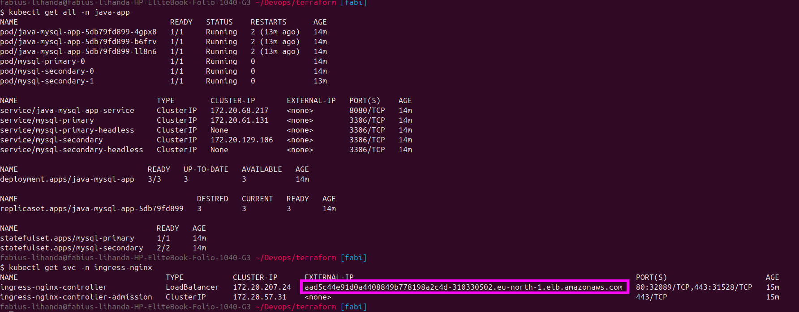
 
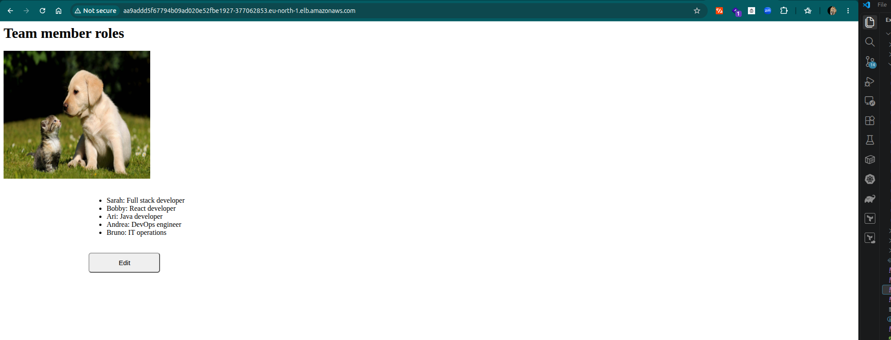
 
</details>

---
<details>
<summary> Exercise 2: Start Monitoring your Applications</summary>

<br />

The goal is to have Prometheus collect metrics from all three components. Everything revolves around one idea: the **Prometheus Operator** watches the cluster for `ServiceMonitor` objects, and each one tells Prometheus *which Service to scrape, on which port and path*. Prometheus operator let's us create custom k8's components defined by Custom Resource Definitions (CRD's)

```
App  →  metrics endpoint  →  Service  →  ServiceMonitor (label matches)  →  Prometheus
```

Third party applications such as MySQL usually need a separate **exporter** application that translates their internal statistics into Prometheus format. But some cloud native applications may have the metrics scraping configuration inside and may not require an additional exporter application, so it is worth checking whether an application's Helm chart already supports it before deploying one.

| Application | Who exposes the metrics | How the ServiceMonitor is created |
|---|---|---|
| Nginx Ingress Controller | The controller itself (cloud native, no exporter needed) | Helm values |
| MySQL | A `mysqld-exporter` container bundled in the Bitnami chart (port 9104) | Helm values |
| Java application | The app itself, through the Prometheus Java client, on port **8081** | Written by hand |

### Deploy the Prometheus Operator

The [`kube-prometheus-stack`](https://github.com/prometheus-community/helm-charts/tree/main/charts/kube-prometheus-stack) chart, from the [prometheus-community Helm charts](https://github.com/prometheus-community/helm-charts) repository, installs Prometheus, Alertmanager, Grafana, node-exporter, kube-state-metrics and the Operator with its custom resource definitions. Two tasks are added to the playbook, one to add the chart repository and one to deploy the stack:

```yaml
    - name: Add Prometheus community Helm repository
      kubernetes.core.helm_repository:
        name: prometheus-community
        repo_url: https://prometheus-community.github.io/helm-charts

    - name: Deploy kube-prometheus-stack (Prometheus Operator)
      kubernetes.core.helm:
        name: monitoring
        chart_ref: prometheus-community/kube-prometheus-stack
        release_namespace: monitoring
        create_namespace: true
        kubeconfig: "{{ kubeconfig }}"
        wait: true
        wait_timeout: 10m
        values:
          alertmanager:
            alertmanagerSpec:
              alertmanagerConfigMatcherStrategy:
                type: None
```

> **Notes:**
> 1. **Automation:** the tasks are placed in the playbook for automation purposes, so the whole setup can be rebuilt with one command. The Prometheus Operator does not have to be deployed through Ansible: the same stack can be installed directly in the cluster with a single Helm command and the necessary options.
> 2. **Placement:** these tasks go right after the namespace task, before the ingress controller. The `ServiceMonitor` resource type is created by the Operator, so it has to exist before the Nginx values, the MySQL values and the Java application manifest ask for one. `wait: true` makes Ansible hold until the stack is ready.
> 3. **Release name:** it is used as a label later. By default Prometheus only picks up ServiceMonitors that carry `release: <helm release name>`, here `release: monitoring`. A ServiceMonitor without it exists but is silently ignored, which is the most common reason for a missing target.
> 4. **`alertmanagerConfigMatcherStrategy`:** this setting is only needed for the notifications in Exercise 4 and is explained there.

### Nginx Ingress Controller

The ingress controller already exposes metrics, so no exporter is needed. The existing ingress controller task only needs the metrics flags in its Helm values, which also create the ServiceMonitor:

```yaml
    - name: Deploy NGINX Ingress Controller via Helm
      kubernetes.core.helm:
        name: ingress-nginx
        chart_ref: ingress-nginx/ingress-nginx
        release_namespace: ingress-nginx
        create_namespace: true
        kubeconfig: "{{ kubeconfig }}"
        values:
          controller:
            metrics:
              enabled: true
              serviceMonitor:
                enabled: true
                additionalLabels:
                  release: monitoring
```

### MySQL

MySQL cannot speak Prometheus on its own, but the Bitnami chart already has the metrics configuration built in: when enabled, it adds a `mysqld-exporter` container next to each MySQL pod, which reads MySQL's internal statistics and republishes them in Prometheus format. The block below is added to [`helm-mysql-values.yaml`](k8_manifests/helm-mysql-values.yaml):

```yaml
metrics:
  enabled: true
  image:
    registry: docker.io
    repository: bitnamilegacy/mysqld-exporter
  serviceMonitor:
    enabled: true
    labels:
      release: monitoring
```

Because of the extra exporter container, the MySQL pods change from `1/1` to `2/2` ready. The `metrics.image` lines point the exporter at the legacy repository for the same reason as the MySQL image (see Challenges).

### Java application

The Java application is monitored through the **Prometheus client libraries**. It registers its own metrics and serves them from a separate HTTP server on port **8081**, which is why the metrics are not on the application's normal port. `AppController.java` defines two metrics, a counter of all requests and a gauge of the requests currently in progress, and both are updated by the `/get-data` and `/update-roles` endpoints:

```java
static final Counter totalRequests = Counter.build()
        .name("java_app_http_requests_total").help("Total requests.").register();
static final Gauge inprogressRequests = Gauge.build()
        .name("java_app_inprogress_requests").help("Inprogress requests.").register();
```

`Application.java` starts the metrics server on port 8081. The bridge line makes the metrics defined in `AppController` visible to that server:

```java
SimpleclientCollector.builder().register();
JvmMetrics.builder().register();   // optional: memory, GC and thread metrics
HTTPServer server = HTTPServer.builder().port(8081).buildAndStart();
```

The matching dependencies in `build.gradle` (excerpt):

```gradle
implementation 'io.prometheus:simpleclient:0.16.0'
implementation 'io.prometheus:prometheus-metrics-core:1.3.3'
implementation 'io.prometheus:prometheus-metrics-exporter-httpserver:1.3.3'
implementation 'io.prometheus:prometheus-metrics-instrumentation-jvm:1.3.3'
implementation 'io.prometheus:prometheus-metrics-simpleclient-bridge:1.3.3'
```

Because the ServiceMonitor selects a Service *by labels* and a port *by name*, the Service in [`application-deployment.yaml`](k8_manifests/application-deployment.yaml) was given a label and a named metrics port next to the application port:

```yaml
apiVersion: v1
kind: Service
metadata:
  name: java-mysql-app-service
  namespace: java-app
  labels:
    app: java-mysql-app
spec:
  selector:
    app: java-mysql-app
  ports:
  - name: http
    port: 8080
    targetPort: 8080
  - name: metrics
    port: 8081
    targetPort: 8081
  type: ClusterIP
```

The ServiceMonitor is added to the same manifest:

```yaml
---
apiVersion: monitoring.coreos.com/v1
kind: ServiceMonitor
metadata:
  name: java-mysql-app
  namespace: java-app
  labels:
    release: monitoring
    app: java-mysql-app
spec:
  endpoints:
  - port: metrics
    path: /metrics
  namespaceSelector: # enables prometheus to discover it since it is in another ns
    matchNames:
    - java-app
  selector:
    matchLabels:
      app: java-mysql-app
```

> **Note:** the metrics are on port **8081**, at the path `/metrics`. The root path `/` serves an HTML landing page, which Prometheus rejects with `received unsupported Content-Type "text/html"`.

### Verify in the Prometheus UI

```bash
kubectl port-forward -n monitoring svc/monitoring-kube-prometheus-prometheus 9090:9090
```

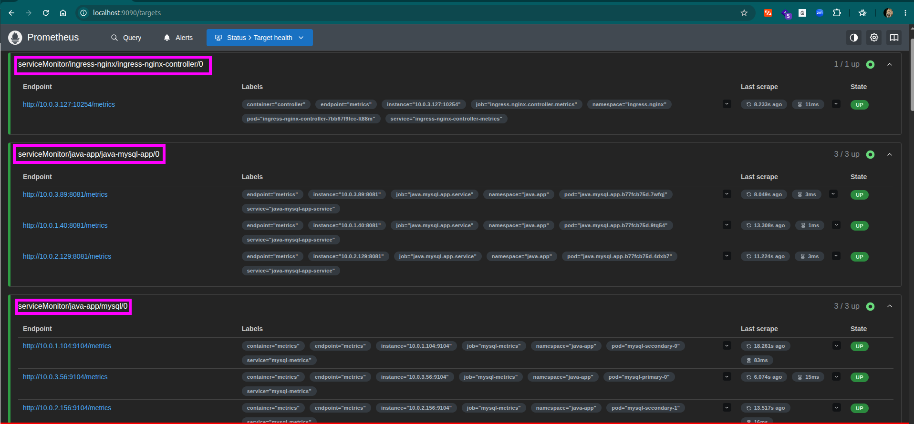

</details>

---

<details>
<summary> Exercise 3: Configure Alert Rules</summary>

<br />

With metrics flowing, the next step is to define what counts as a problem. Alert rules are `PrometheusRule` resources, which the Operator loads into Prometheus. Like ServiceMonitors they need the `release: monitoring` label.

| Application | Alert | Condition |
|---|---|---|
| Nginx Ingress | `NginxHighHttp4xxRate` | More than 5% of HTTP requests have status 4xx |
| MySQL | `MysqlDown` | All MySQL instances are down |
| MySQL | `MysqlTooManyConnections` | More than 80% of the maximum connections are in use |
| Java application | `JavaAppTooManyRequests` | More than 10 requests per second |
| Kubernetes | `StatefulSetReplicasMismatch` | A StatefulSet has fewer ready replicas than expected |

### Implementation

```yaml
apiVersion: monitoring.coreos.com/v1
kind: PrometheusRule
metadata:
  name: java-app-rules
  namespace: monitoring
  labels:
    app: kube-prometheus-stack
    release: monitoring
spec:
  groups:
  - name: nginx.rules
    rules:
    - alert: NginxHighHttp4xxRate
      expr: |
        sum(rate(nginx_ingress_controller_requests{status=~"4.."}[1m]))
        /
        sum(rate(nginx_ingress_controller_requests[1m])) * 100 > 5
      for: 1m
      labels:
        severity: warning
      annotations:
        summary: "Too many 4xx errors on nginx-ingress"
        description: "{{ $value | printf \"%.1f\" }}% of HTTP requests returned 4xx\n Value = {{ $value }}"

  - name: mysql.rules
    rules:
    - alert: MysqlDown
      expr: sum(mysql_up) == 0 or absent(mysql_up)
      for: 0m
      labels:
        severity: critical
      annotations:
        summary: "MySQL down (all instances)"
        description: "No MySQL instance is up\n Value = {{ $value }}"

    - alert: MysqlTooManyConnections
      expr: mysql_global_status_threads_connected / mysql_global_variables_max_connections * 100 > 80
      for: 2m
      labels:
        severity: warning
      annotations:
        summary: "MySQL too many connections (instance {{ $labels.instance }})"
        description: "{{ $value | printf \"%.0f\" }}% of max connections used\n LABELS = {{ $labels }}"

  - name: java-app.rules
    rules:
    - alert: JavaAppTooManyRequests
      expr: sum(rate(java_app_http_requests_total[1m])) > 10
      for: 1m
      labels:
        severity: warning
      annotations:
        summary: "Java application receiving too many requests"
        description: "Request rate is {{ $value | printf \"%.1f\" }} per second\n Value = {{ $value }}"

  - name: kubernetes.rules
    rules:
    - alert: StatefulSetReplicasMismatch
      expr: kube_statefulset_status_replicas_ready != kube_statefulset_status_replicas
      for: 1m
      labels:
        severity: critical
      annotations:
        summary: "StatefulSet {{ $labels.statefulset }} has unready replicas"
        description: "Namespace {{ $labels.namespace }}\n Value = {{ $value }}"
```

### How the rules work

Each rule has an `expr` (a PromQL query), a `for` duration, `labels` and `annotations`. The `for` causes prometheus to wait for a certain duration to see if the application could resolve itself before firing the alert, `labels` allow a custom set of additional labels to be attached to an alert, and finally `annotations` specify a set of informational labels for longer additional information.

An alert moves through three states:

```
condition false           → Inactive
condition true            → Pending  (waiting out `for`)
still true after `for`    → Firing   (sent to Alertmanager)
```

- **Nginx 4xx:** `nginx_ingress_controller_requests` is a counter with one series per status code. The regex `4..` matches every 4xx code, `rate()` turns the counters into requests per second, and dividing the two sums gives the share of 4xx responses.
- **MySQL down:** `mysql_up` is `1` per reachable MySQL instance. `sum(...) == 0` means every instance is down. `absent(mysql_up)` covers the case where the pods are gone completely: their series disappear, `sum()` then returns nothing instead of 0, and the alert would never fire without it.
- **MySQL connections:** current connections divided by the configured maximum, evaluated per instance.
- **Java requests:** `rate()` of the application's own counter, summed over all 3 replicas so the threshold applies to the whole application.
- **StatefulSet mismatch:** both metrics come from kube-state-metrics, which the stack installs. Since MySQL runs as a StatefulSet, a lost replica triggers it.

The `severity` label does not change how Prometheus behaves. It is a tag that Alertmanager can use for routing. 
>`runbook_url` can be added to the annotations part to  provide a list of links for a probable solution fix for an issue, this makes it easy to access documentation for a particular issue. This could be a repository wiki page in common wiki platforms; Github, gitlab, confluence, notion, etc.

#### Verify

```bash
kubectl apply -f k8_manifests/alert-rules.yaml
kubectl get prometheusrule -n monitoring
```

All five alerts are listed on `http://localhost:9090/alerts` and stay green while everything is healthy.

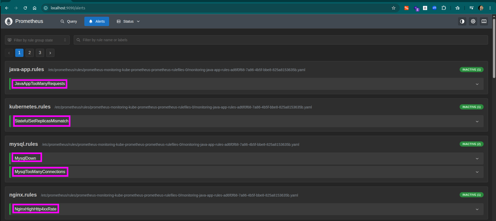

</details>

---

<details>
<summary> Exercise 4: Send Alert Notifications</summary>

<br />

Alerts that only show up in the Prometheus UI help nobody who is not looking at it. **Alertmanager** receives the firing alerts and decides *who* is notified, *where*, and *how often*. The routing required here is split by team:

| Alerts | Destination |
|---|---|
| Java application and MySQL | Developers' **Slack** channel |
| Nginx Ingress Controller and Kubernetes components | Administrator's **email** |

### Slack webhook

1. Create a Slack workspace and a channel for the alerts.
2. On `api.slack.com/apps` choose **Create New App → Blank app**.

   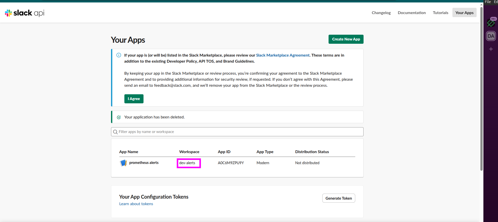

3. Open **Incoming Webhooks**, switch them on, click **Add New Webhook to Workspace**, pick the channel and copy the URL.
   
   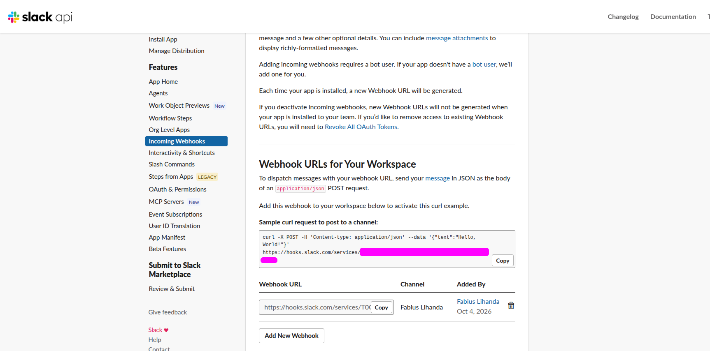

   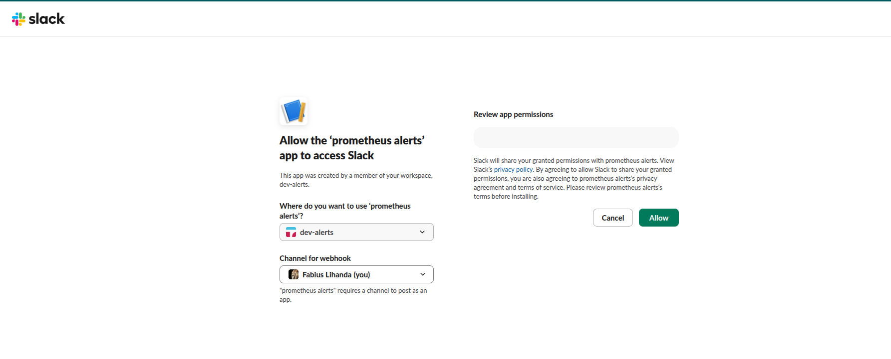
   
4. Test it before involving Kubernetes:

```bash
curl -X POST -H 'Content-type: application/json' \
  --data '{"text":"Test message from Prometheus setup"}' \
  '<webhook-url>'
```
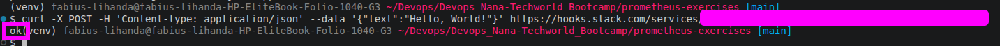


### Gmail app password

Alertmanager sends the emails through Gmail's SMTP server. Gmail does not accept a normal account password for this, so an **app password** is created for Alertmanager to use instead.

1. Sign in to the Google account that will send the alert emails.
2. Turn on **2-Step Verification** under **Manage your Google Account → Security → 2-Step Verification**. App passwords are only available once it is on.
3. Open **App passwords** (search for "App passwords" in the account settings), enter a name such as `alertmanager` and click **Create**.
4. Copy the 16 character password that Google shows. It is displayed only once, and the spaces in it are not part of the password.
5. Test it before involving Kubernetes, with an email sent through the same SMTP server.

The app password is a credential, so it is stored in a Kubernetes Secret and never committed to the repository.


### Secrets

Alertmanager reads the credentials from Kubernetes Secrets in the `monitoring` namespace instead of having them in the configuration:

```yaml
apiVersion: v1
kind: Secret
type: Opaque
metadata:
  name: slack-webhook
  namespace: monitoring
stringData:
  url: <slack-webhook-url>
---
apiVersion: v1
kind: Secret
type: Opaque
metadata:
  name: gmail-auth
  namespace: monitoring
stringData:
  password: <gmail-app-password>
```

### AlertmanagerConfig

```yaml
apiVersion: monitoring.coreos.com/v1alpha1
kind: AlertmanagerConfig
metadata:
  name: java-app-alert-config
  namespace: monitoring
spec:
  route:
    receiver: 'null'           # default: anything not matched below is discarded
    repeatInterval: 30m        # if the issue still persists, notify again after 30 minutes
    routes:
    - receiver: 'slack'
      matchers:
      - name: alertname
        value: 'JavaAppTooManyRequests|MysqlDown|MysqlTooManyConnections'
        matchType: '=~'
      repeatInterval: 30m
    - receiver: 'email'
      matchers:
      - name: alertname
        value: 'NginxHighHttp4xxRate|StatefulSetReplicasMismatch'
        matchType: '=~'
      repeatInterval: 30m

  receivers:
  - name: 'null'
  - name: 'slack'
    slackConfigs:
    - apiURL:
        name: slack-webhook
        key: url
      channel: 'dev-alerts'
      sendResolved: true
      title: '[{{ .Status | toUpper }}] {{ .CommonLabels.alertname }}'
      text: '{{ range .Alerts }}{{ .Annotations.summary }}{{ "\n" }}{{ .Annotations.description }}{{ "\n" }}{{ end }}'

  - name: 'email'
    emailConfigs:
    - to: '<recipient-address>'
      from: '<sender-address>'
      smarthost: 'smtp.gmail.com:587'
      authUsername: '<sender-address>'
      authIdentity: '<sender-address>'
      authPassword:
        name: gmail-auth
        key: password
      sendResolved: true
```

> **Note on the `null` receiver:** `null` is a receiver without any configuration, so it sends nothing. It is the default, which means every alert that matches neither route is discarded. `kube-prometheus-stack` ships many built-in alerts, such as `Watchdog`, which always fires on purpose, and `KubeControllerManagerDown` and `KubeSchedulerDown`, which are false alarms on Amazon EKS, where AWS manages the control plane. Without a `null` default they would flood the inbox and hide the real alerts. Discarded alerts still fire in Prometheus and show in the Alertmanager UI, they just send no notification.

- **Routes** are checked from top to bottom and the first match wins. `matchType: '=~'` is a regex match, so one route covers several alert names.
- **`repeatInterval`** is how long Alertmanager waits before notifying again while an alert is still firing.
- **`sendResolved: true`** sends a second message when the problem clears.
- The default receiver `null` has no configuration, so alerts that match no route are dropped instead of being sent to someone's inbox.

### Required stack setting

By default, the Prometheus Operator only lets an `AlertmanagerConfig` handle alerts that carry the label `namespace="monitoring"`, the namespace the config lives in. This rule exists for shared clusters: it stops one team's config from catching, or interfering with, another team's alerts.

The alerts in this project don't have that label (the Java and Nginx alerts have no namespace at all, and the StatefulSet alert has `namespace="java-app"`), so they fire in Prometheus but **no notification is ever sent**.

On a single-team cluster this protection isn't needed, so it is switched off in the values of the `kube-prometheus-stack` task:

```yaml
        values:
          alertmanager:
            alertmanagerSpec:
              alertmanagerConfigMatcherStrategy:
                type: None
```

The resources are applied with `kubectl`. The secrets go first, so they exist when the Alertmanager config loads, and the Operator's custom resource definitions have to be there already:

```bash
kubectl apply -f slack-secret.yaml
kubectl apply -f email-secret.yaml
kubectl apply -f alert-rules.yaml
kubectl apply -f alert-manager-configuration.yaml
```

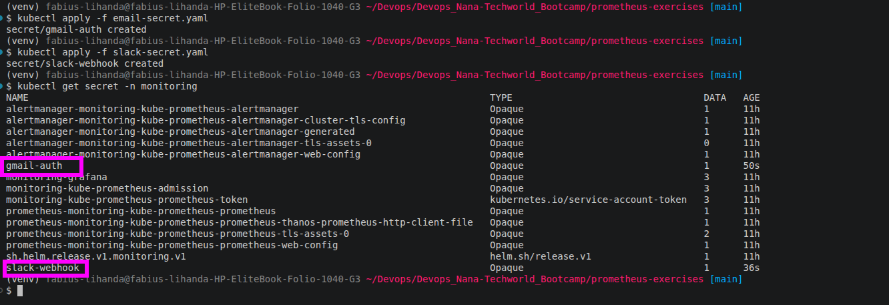

```bash
kubectl port-forward -n monitoring svc/monitoring-kube-prometheus-alertmanager 9093:9093
```

On `http://localhost:9093` the **Status** page lists both receivers and the route tree, and firing alerts show the receiver they were routed to.


</details>

---

<details>
<summary> Exercise 5: Test the Alerts</summary>

<br />

A configuration that has never fired is only a guess. This exercise simulates real failures to trigger at least one alert for each notification channel. Each test follows the same timeline: the metric changes, the alert goes **Pending**, then **Firing** after its `for` duration, Alertmanager routes it, and the notification arrives about 30 seconds later (the default group wait). When the problem stops, a **RESOLVED** message follows.

| Test | How | Alert | Channel |
|---|---|---|---|
| Java load | Parallel requests to `/get-data` | `JavaAppTooManyRequests` | Slack |
| Unknown path | Requests to a path that does not exist | `NginxHighHttp4xxRate` | Email |
| MySQL down | Scale the StatefulSets to 0 | `MysqlDown` | Slack |
| Lost replica | Delete one MySQL secondary pod | `StatefulSetReplicasMismatch` | Email |

### Java application: too many requests

```bash
#!/usr/bin/env bash
# Triggers the JavaAppTooManyRequests alert by sending parallel requests to /get-data.
#
# Usage:   ./trigger_javaapp_alert.sh <ingress-hostname> [total-requests] [parallel]
# Example: ./trigger_javaapp_alert.sh my-alb.elb.amazonaws.com 6000 20
#
# The alert fires when sum(rate(java_app_http_requests_total[1m])) > 10
# for 1 minute. If the rate stays below 10, raise [parallel] (e.g. 50).

HOST=$1
TOTAL=${2:-6000}
PARALLEL=${3:-20}

if [ -z "$HOST" ]; then
  echo "Usage: $0 <ingress-hostname> [total-requests] [parallel]"
  exit 1
fi

echo "Sending $TOTAL requests to http://$HOST/get-data ($PARALLEL in parallel)..."
seq 1 "$TOTAL" | xargs -P "$PARALLEL" -I{} curl -s -o /dev/null "http://$HOST/get-data"
echo "Done."
```

Only calls to `/get-data` and `/update-roles` increment the application's counter, so a request to any other path does not move this alert. The request rate reached about 52 requests per second, far above the threshold of 10.

The script is run with the hostname of the load balancer, and it sends the requests in parallel:

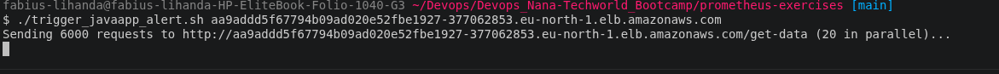

Within a minute the request rate is above the threshold, and the alert goes to **Pending** in Prometheus. The condition is true, but the alert has to stay true for the full `for: 1m` before it fires:

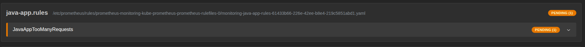

Once the minute has passed, the alert is **Firing** and Prometheus hands it to Alertmanager:

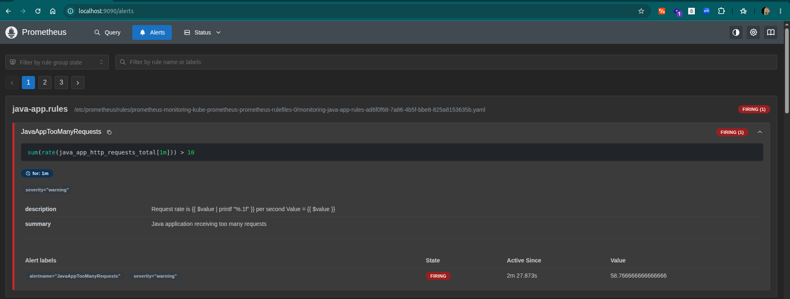

About 30 seconds later, the notification arrives in the Slack channel, because Alertmanager routed the alert to the `slack` receiver:

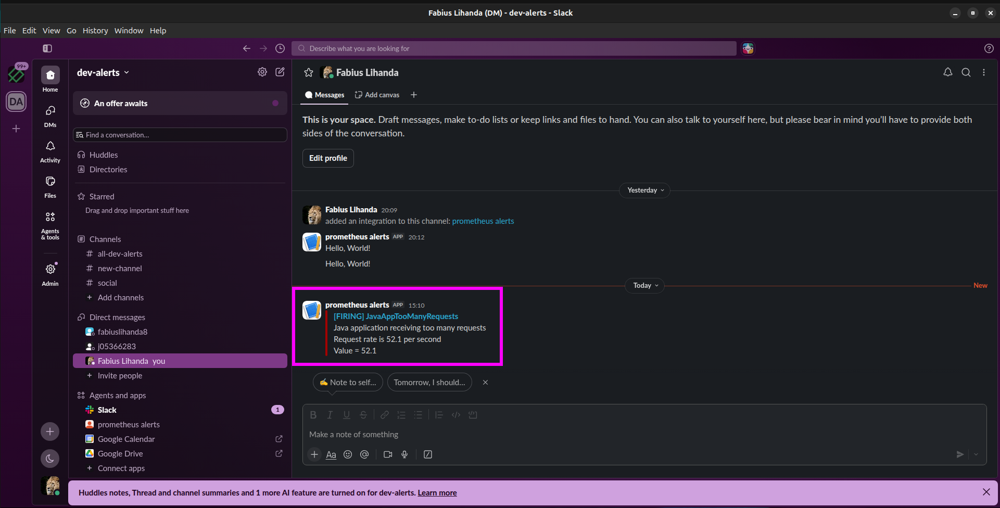

When the load stops, the request rate drops, the alert clears, and Slack receives a **RESOLVED** message:

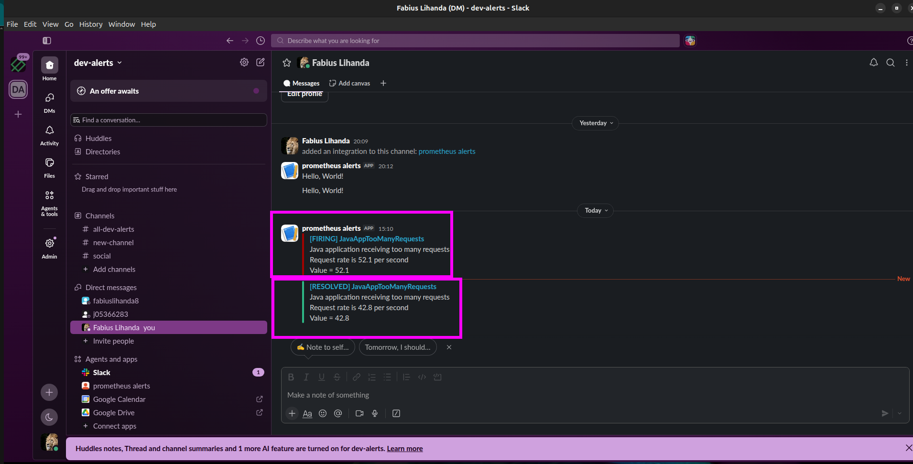


### Nginx: too many 4xx responses

```bash
#!/usr/bin/env bash
HOST=$1
COUNT=${2:-600}
for i in $(seq 1 $COUNT); do
  curl -s -o /dev/null http://$HOST/path-that-doesnt-exist
  sleep 0.2
done
```

Every request returns a 404, so the 4xx share jumps toward 100% while the script runs and the alert follows after its one minute.

The script is run with the hostname of the load balancer, and it keeps requesting a path that does not exist:

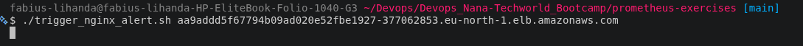

Once more than 5% of the requests have been 4xx for a full minute, the alert is **Firing** in Prometheus and is handed to Alertmanager:

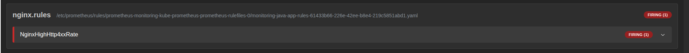

About 30 seconds later the notification arrives by email, because Alertmanager routed the alert to the `email` receiver:

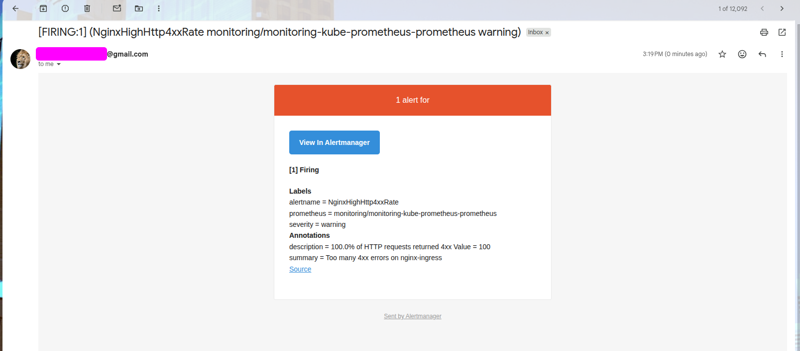


### MySQL

Deleting a single secondary pod triggers the StatefulSet alert, not `MysqlDown`, because that alert is defined as *all* instances down:

```bash
kubectl delete pod mysql-secondary-1 -n java-app
```

To test `MysqlDown`, all MySQL pods are stopped. The data stays on the persistent volumes, so nothing is lost:

```bash
kubectl scale sts mysql-primary mysql-secondary -n java-app --replicas=0
```

The MySQL pods are terminated, and the cluster no longer has any MySQL instance:

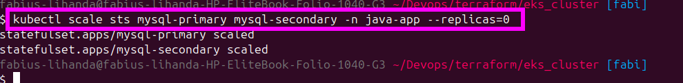

With the pods gone, their `mysql_up` metrics disappear as well. This is the case that `absent(mysql_up)` in the alert rule covers, so the alert fires even though there are no exporters left to report that MySQL is down:

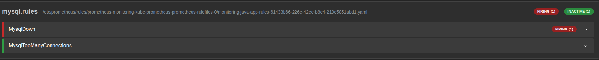

Meanwhile the Java application is running without its database, so the page that depends on MySQL no longer shows any data:

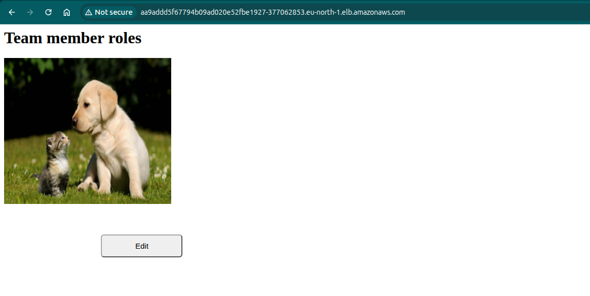

To recover, MySQL is scaled back to its original size (1 primary and 2 secondaries), and the Java application is restarted:

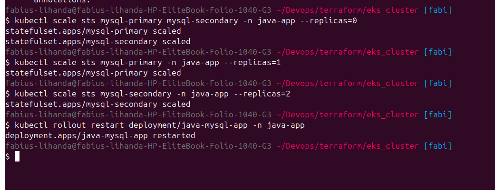

```bash
# recovery
kubectl scale sts mysql-primary -n java-app --replicas=1
kubectl scale sts mysql-secondary -n java-app --replicas=2
kubectl rollout restart deployment/java-mysql-app -n java-app
```

The restart of the Java application is needed because its single database connection does not reconnect by itself.
Finally, the restarted Java pods reconnect to the database, and the application shows its data again:


Alertmanager routes the alert to the `slack` receiver. Slack receives a **FIRING** message while MySQL is down, and a **RESOLVED** message once the exporters report it as up again:

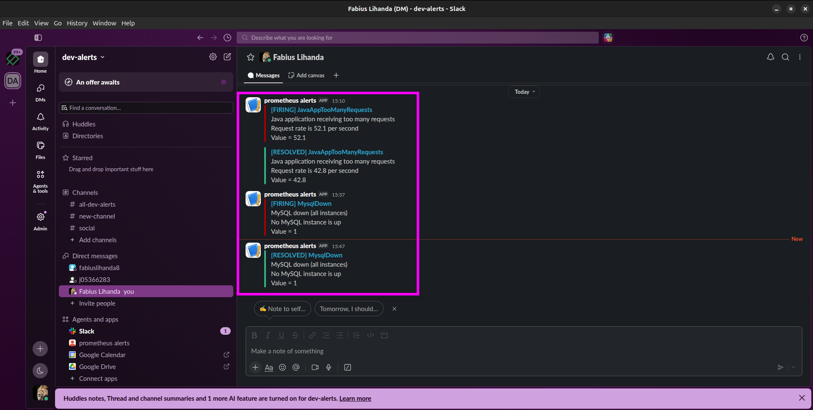

</details>

---
<details>
<summary> Grafana Dashboard</summary>

<br />

Prometheus stores and alerts on the metrics, but Grafana makes them easy to read. It is installed by the same `kube-prometheus-stack` chart and already has Prometheus configured as its data source, so only the dashboard had to be built. Grafana is reached with a port-forward, and the admin password is stored in a Kubernetes Secret:

```bash
kubectl port-forward -n monitoring svc/monitoring-grafana 8082:80
kubectl get secret -n monitoring monitoring-grafana -o jsonpath="{.data.admin-password}" | base64 -d
```

The dashboard, **Java App Traffic**, is split into four sections, one for each part of the setup, so that traffic and health can be followed at a glance:

| Row   | Panel | Query | Type | Unit |
|---|---|---|---|---|
| Nginx | Nginx requests by status | `sum by (status) (rate(nginx_ingress_controller_requests[1m]))` | Time series | requests/sec |
| Nginx | Nginx 4xx percentage | `sum(rate(nginx_ingress_controller_requests{status=~"4.."}[1m])) / sum(rate(nginx_ingress_controller_requests[1m])) * 100` | Gauge | Percent (0-100) |
| Java App | Java app request rate (per pod) | `sum by (pod) (rate(java_app_http_requests_total[1m]))` | Time series | requests/sec |
| Java App | Java app in-progress requests | `sum(java_app_inprogress_requests)` | Stat | none |
| MySQL | MySQL connections | `mysql_global_status_threads_connected` | Time series | none |
| MySQL | MySQL instances up | `sum(mysql_up) or vector(0)` | Stat | none |
| StatefulSets Replicas | StatefulSet ready replicas | `kube_statefulset_status_replicas_ready{namespace="java-app"}` | Time series | none |

Each panel is created with **Dashboards → New → New dashboard → Add visualization**: select the **Prometheus** data source, switch the query editor from *Builder* to *Code*, paste the query, then choose the visualization type, the unit and a title.

`or vector(0)` on the *MySQL instances up* panel makes it show **0** when all instances are gone, instead of "No data". The same case is handled in the alert rule with `absent()`, but that function does not belong in the panel, because `absent()` returns 1 when something is missing.

#### Before the tests

With nothing happening, the request rates stay flat. In MySQL, the connections are steady, all 3 instances are up, and the StatefulSets report their replicas as ready. This is the baseline for the tests of Exercise 5:

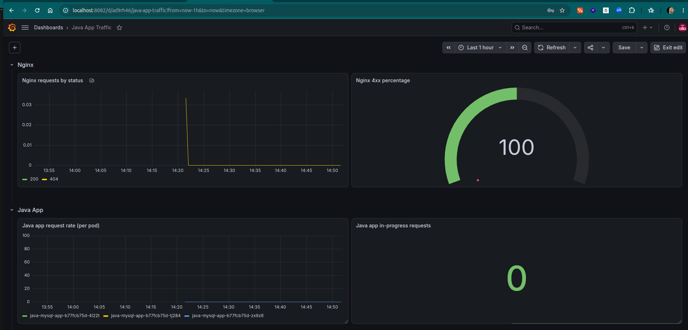

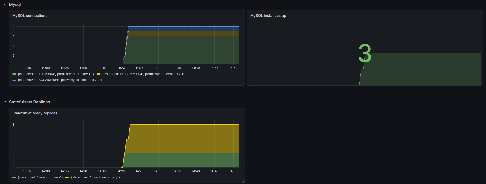

#### After the Java application test

The load script produces a clear spike on both sections. Nginx shows the `200` responses climbing to about 50 requests per second, and the request rate per pod peaks at about 17 on each of the three replicas, around 52 in total. This is far above the alert threshold of 10:

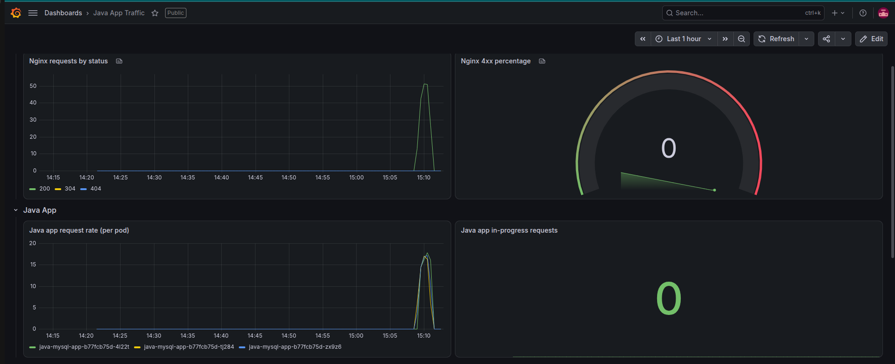

#### After the Nginx test

The requests to a path that does not exist are all counted as `404`. The `404` line rises in *Nginx requests by status*, and the *Nginx 4xx percentage* gauge goes to 100, well beyond the 5% of the alert:

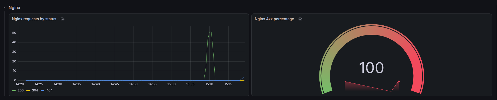

#### After the MySQL test

When the MySQL pods are scaled down, *MySQL instances up* drops to 0, the connections disappear, and the ready replicas of both StatefulSets fall to 0. They rise again once MySQL is scaled back up:

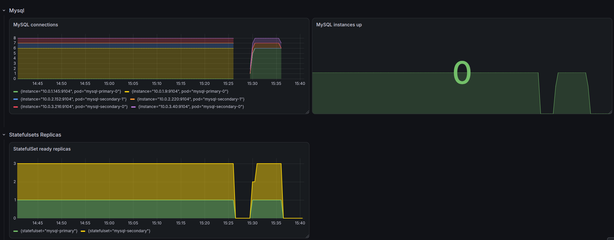

</details>

---

<details>
<summary>Challenges</summary>

<br />

### 1. `ImagePullBackOff` on the MySQL exporter

After enabling `metrics.enabled` in the MySQL values, the MySQL pods showed `1/2` ready, with the exporter container stuck pulling its image:

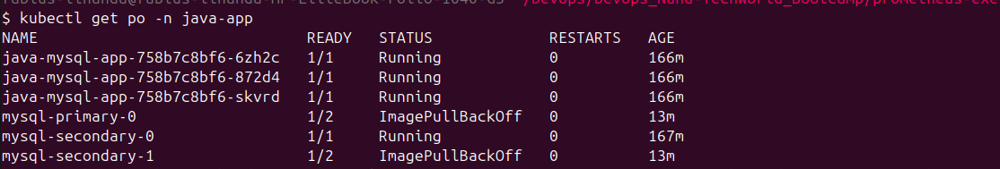

`mysql-primary-0` and `mysql-secondary-1` were stuck in `ImagePullBackOff`, while `mysql-secondary-0` was still `1/1` and running. A StatefulSet updates one pod at a time and waits for each one to become ready, so the remaining pod stayed on the old version and kept running. It is a safety feature: a bad update stops instead of breaking every replica, which is why the database kept serving the application during the failure.

The cause: the default exporter image comes from the Bitnami repository affected by the 2025 catalogue change, so it can no longer be pulled. Pointing it at the legacy repository, as already done for MySQL itself, fixed it:

```yaml
metrics:
  image:
    registry: docker.io
    repository: bitnamilegacy/mysqld-exporter
```
I then deleted the old failed pods and rolled out the restart deployment of the app to sync with the changes

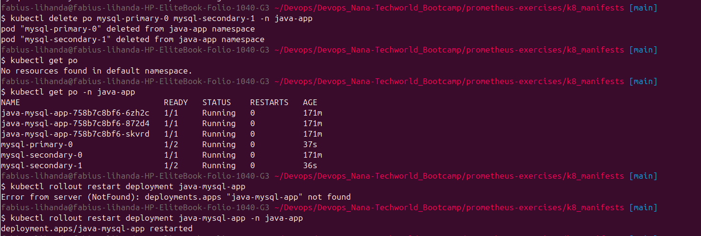


---

### 2. Alerts firing in Prometheus, but no notifications

The alerts reached the **Firing** state in Prometheus, and the Slack webhook worked when it was tested directly with `curl`, yet nothing arrived in Slack. The Alertmanager log had no entries about Slack at all, which meant it never even tried to send anything. The alert only carried two labels, `alertname` and `severity`.

The cause: the Prometheus Operator automatically adds a `namespace="monitoring"` matcher to every route of an `AlertmanagerConfig`, the namespace the config lives in. This protects shared clusters from one team's config catching another team's alerts. The alerts in this project do not carry that label, so none of them matched a route.

The fix was to switch off that matcher in the values of the `kube-prometheus-stack` task:

```yaml
              alertmanagerConfigMatcherStrategy:
                type: None
```

With `type: None`, the routes only use the matchers written in the config, and the alerts reached Slack and email. 

---

### 3. False alarms from built-in alerts

Once the notifications worked, alerts that were never configured started to arrive in the inbox: `Watchdog`, `KubeControllerManagerDown` and `KubeSchedulerDown`.

The cause: they are default alerts of `kube-prometheus-stack` that were firing all along, but the namespace matcher from the previous challenge had been hiding them. Switching it off let every alert reach the config, and each one that matched neither route fell through to the default receiver, which was `email`. `Watchdog` fires on purpose to prove that the pipeline works, and the other two can never be fixed on Amazon EKS, because AWS manages the control plane and does not expose those components to Prometheus.

The fix was to make the default receiver a `null` receiver, defined without any configuration, so that everything that was not routed on purpose is discarded:

```yaml
spec:
  route:
    receiver: 'null'
  receivers:
  - name: 'null'
```

</details>

---


